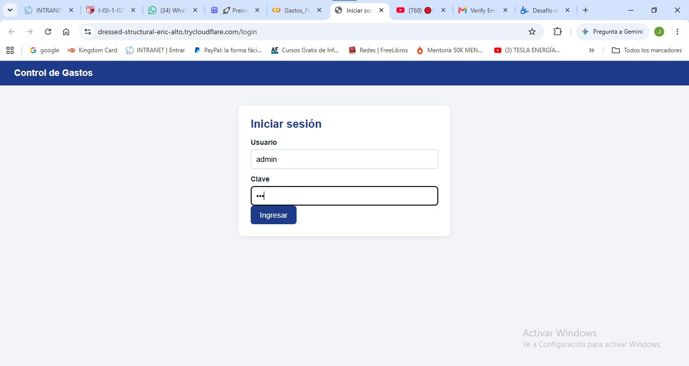
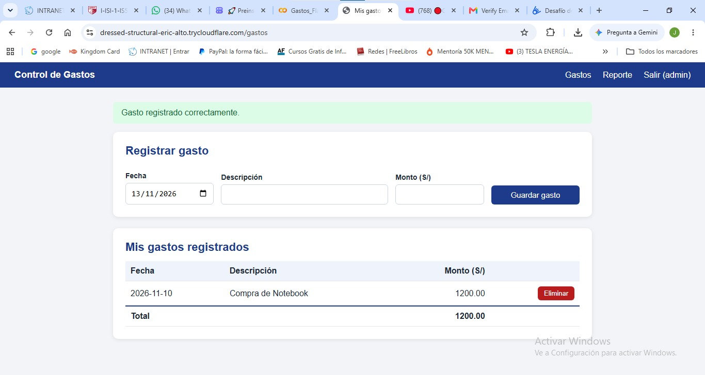
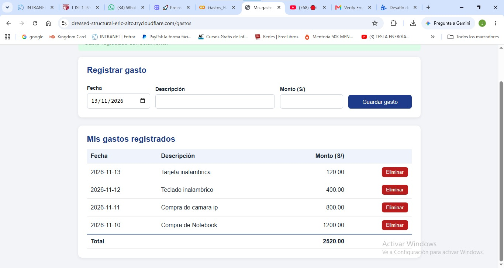
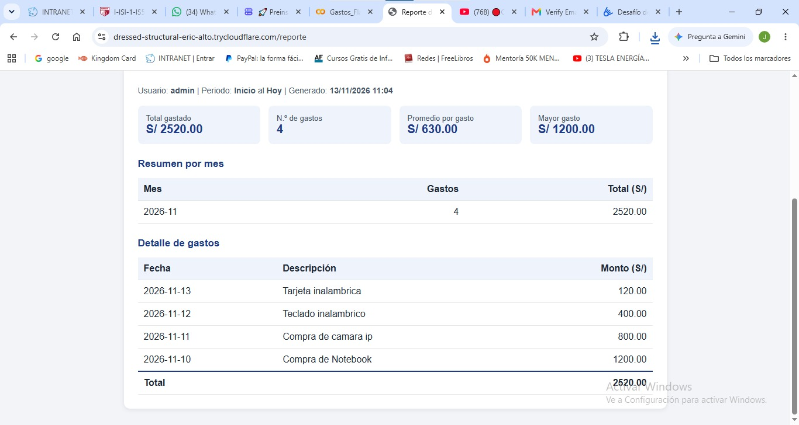
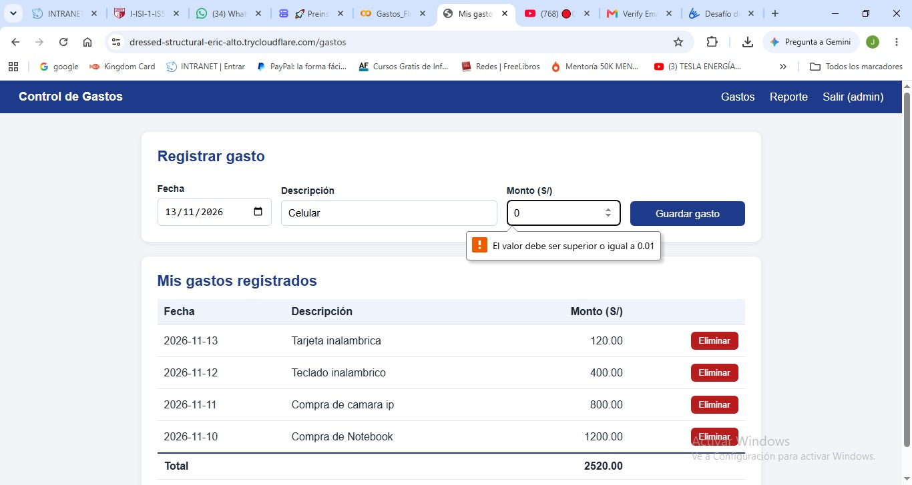

# Control de Gastos con Flask

Sitio web desarrollado con **Python, Flask y SQLite** que permite iniciar sesión, registrar gastos (fecha, descripción y monto) y generar un reporte.

**Autor:** Isaú José Arredondo Gutiérrez
**Curso:** Programación y Desarrollo Web
**Universidad:** Universidad Privada de Trujillo

## Credenciales de acceso

| Usuario | Clave |
|---------|-------|
| `admin` | `123`   |

## Funcionamiento

1. **Inicio de sesión:** el usuario ingresa con `admin` / `123`. La clave se guarda cifrada (hash) en la base de datos y se valida con `check_password_hash`. Si las credenciales son incorrectas, se muestra un mensaje de error.
2. **Registro de gastos:** en la pantalla **Gastos** se completa la fecha, la descripción y el monto, y se presiona **Guardar gasto**. El sistema valida que la fecha sea correcta y no futura, que la descripción tenga entre 3 y 120 caracteres y que el monto sea mayor que 0.
3. **Listado de gastos:** los gastos registrados se muestran ordenados del más reciente al más antiguo, con el total acumulado. Cada gasto se puede eliminar.
4. **Reporte:** en la pantalla **Reporte** se pueden filtrar los gastos por rango de fechas y se muestran el total gastado, la cantidad de gastos, el promedio, el mayor gasto, el resumen por mes y el detalle. El reporte se puede **descargar en CSV** o **imprimir**.
5. **Cerrar sesión:** el botón **Salir** destruye la sesión. Las pantallas de gastos y reporte solo están disponibles con la sesión iniciada.

## Capturas de la aplicación

### 1. Inicio de sesión


### 2. Registro de un gasto


### 3. Listado de gastos


### 4. Reporte de gastos


### 5. Validación de datos


## Tecnologías

- Python 3
- Flask (rutas, sesiones y plantillas Jinja2)
- SQLite (módulo `sqlite3`)
- Werkzeug (`generate_password_hash` y `check_password_hash`)
- HTML y CSS

## Estructura del proyecto

```
gastos-flask/
├── app.py
├── requirements.txt
├── README.md
├── .gitignore
├── capturas/
├── static/
│   └── style.css
└── templates/
    ├── base.html
    ├── login.html
    ├── gastos.html
    ├── reporte.html
    └── error.html
```

## Instalación y ejecución local

```bash
git clone https://github.com/USUARIO/gastos-flask.git
cd gastos-flask
python -m venv .venv
source .venv/bin/activate
pip install -r requirements.txt
python app.py
```

En Windows, la activación del entorno virtual es `.venv\Scripts\activate`.

Abrir en el navegador: http://127.0.0.1:5000

La base de datos `gastos.db` se crea automáticamente al iniciar la aplicación, junto con el usuario `admin`.

## Seguridad

- Contraseñas almacenadas con hash.
- Consultas SQL parametrizadas contra inyección SQL.
- Validación de fecha, descripción y monto en el servidor.
- Plantillas Jinja2 con escape automático contra XSS.
- Exportación a CSV protegida contra inyección de fórmulas.
